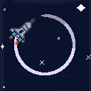
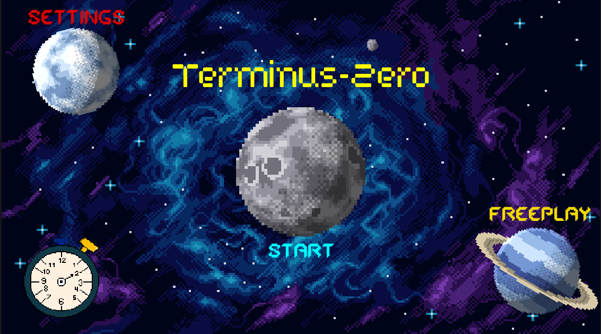
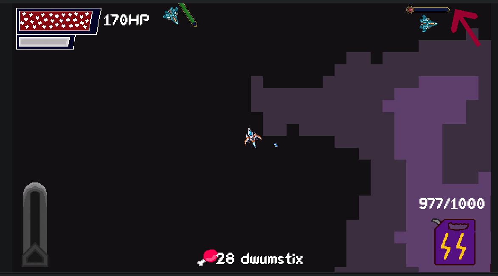
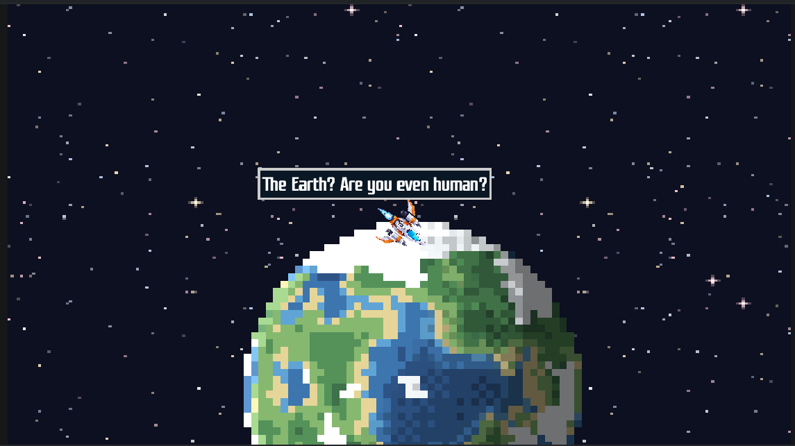

# Terminus Zero : An Ending? A Start?
## A Game by [Hazorox](https://github.com/hazorox/) - [Vii](https://github.com/vii-abdullatif) - [Aboel5yr](https://github.com/adhammohamedkhairy)
### Live on [itch.io](https://hazoro.itch.io/terminus-zero)
<center>  </center>

# Lore
You're a space ship, Spx. You suddenly woke up to found yourself in space, with other spaceships and monsters hunting you down.

You're set on a mission to return back to Earth

--Secret Plot Twist--

# Gameplay:
- Fight enemies (The compass in your HUD points to the nearest enemy)
- Get Dwumsticks :3 (30+)
- GET MANY Dwumsticks
- Refuel your big tank
- BOOOOOOOST To Earth :D
## Controls:
- Steer : A >> Left, D >> Right
- Thrust : W
- Brakes : S
- Boost : Space
- Shoot : LMB (unchangable)
- Pause : Escape
- Force Reset : Escape Hold for 3 seconds

# Gallery




# Setup
```sh
git clone https://github.com/adhammohamedkhairy/terminus-zero
cd terminus-zero # Open project with Godot 4.7
```
# Claude?:
## Hazoro:
- Debugging issues with the acceleration system in player spaceship
- Debug an issue in the cutscene caused by conflicting events

# That's all <3